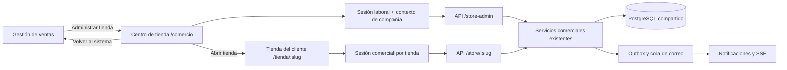

# Centro de tienda: arquitectura de un módulo administrativo independiente

**Fecha:** 8 de noviembre de 2026. **Base analizada:** `main`, commit `6d81562`.

**Estado:** diseño original de referencia. La base de contexto y espacio administrativo ya está implementada; consultar [alcance y verificación de las fases 1–2](implementacion-fases-1-2.md) para distinguir funciones entregadas de propuestas posteriores.

Las fases de operación y gestión también cuentan con [implementación y evidencia de las fases 3–4](implementacion-fases-3-4.md).

## 1. Resultado que se busca

Desde el sistema de ventas, el administrador pulsa **Tienda virtual → Administrar tienda** y entra en `/comercio`, una página con su propio dashboard, menú lateral, buscador, bandeja de pedidos y configuración. Puede volver a Gestión de ventas o abrir la tienda de sus clientes.

La independencia inicial es de **experiencia, rutas y límites de módulo**, dentro del Next.js y NestJS existentes. Se mantienen la sesión laboral, la compañía activa, el inventario y los servicios comerciales. Una segunda aplicación o un microservicio no son necesarios para conseguir esta separación.

### Documentos de la propuesta

1. [Arquitectura, decisiones y contratos](README.md) — este documento.
2. [Modelo de datos y migraciones](modelo-datos.md).
3. [Diseño UI/UX, pantallas y recorridos](diseno-ui-ux.md).
4. [Plan de integración y aceptación](plan-integracion.md).
5. [Prototipo interactivo del panel](prototipo-panel.html) — abrir en el navegador; datos ficticios, sin conexiones a las APIs.

## 2. Diagnóstico del repositorio

| Evidencia actual                                                                         | Consecuencia                                                                                                 | Decisión propuesta                                                          |
| ---------------------------------------------------------------------------------------- | ------------------------------------------------------------------------------------------------------------ | --------------------------------------------------------------------------- |
| `frontend/app/(dashboard)/store/page.tsx` usa `StoreAdmin` dentro del layout general     | La tienda no se percibe como un área de trabajo propia                                                       | Layout dedicado en otro grupo de rutas                                      |
| `StoreAdmin` monta ajustes, publicación, `StoreAdminCommerce`, pedidos y clientes juntos | Página extensa; cargar una sección puede solicitar información de otras                                      | Una ruta y un límite de carga por función                                   |
| `StoreAdminOrders` carga pedidos, integración e incidencias en la misma operación        | Una incidencia de configuración puede afectar la carga de pedidos                                            | Separar consultas y estados de error                                        |
| El detalle de pedido vive en estado local                                                | No hay enlace directo ni recuperación cómoda tras recargar                                                   | `/comercio/pedidos/[id]` como ruta real                                     |
| Predomina el permiso `store:manage` y las rutas exigen `COMPANY_ADMIN`                   | No hay delegación granular disponible hoy                                                                    | Mantener dueño en MVP; diseñar permisos específicos para una fase posterior |
| `/atencion-tienda` y `StoreCloseoutGuard` atienden operaciones existentes                | Una reorganización podría bloquear devoluciones y entregas si hereda las restricciones del dashboard general | Modo de atención restringida explícito                                      |
| API `/api/store-admin/*` y API de clientes `/api/store/:slug/*` ya están separadas       | Existe un límite de dominio útil                                                                             | Conservar estos contratos y ampliarlos de forma aditiva                     |
| `StoreOrder.snapshot`, reservas, cobros, kardex y outbox están implementados             | Rehacer el checkout introduciría riesgo de regresión                                                         | El nuevo panel invoca los mismos comandos comerciales                       |
| No hay un endpoint administrativo de dashboard ni filtros operativos completos           | Un gráfico construido con los primeros 30 pedidos sería incompleto                                           | Agregaciones del servidor, con período, alcance y definiciones explícitas   |

### Fuentes comprobadas

- `frontend/components/store/store-admin.tsx`, `store-admin-orders.tsx`, `store-admin-commerce.tsx`, `store-admin-customers.tsx`.
- `frontend/app/(dashboard)/layout.tsx`, `frontend/app/(store)/atencion-tienda/page.tsx`.
- `frontend/components/layout/app-sidebar.tsx`, `frontend/lib/role-navigation.ts`, `frontend/proxy.ts`.
- `backend/src/modules/store/store.controller.ts`, `store-orders.controller.ts`, `store-closeout.guard.ts`, `store-orders.service.ts`.
- `backend/src/common/constants/permissions.constant.ts`, `backend/prisma/schema.prisma`.
- [Plan de modernización aplicado](../plan-tienda-moderna.md) y [corrección del flujo de confirmación](../correccion-confirmacion-carrito-pago.md).

Los documentos históricos de implementación contienen decisiones que luego evolucionaron. Para el comportamiento actual prevalecen el código de esta base y la corrección de confirmación, no los recuentos de pruebas o descripciones antiguas.

## 3. Decisiones de arquitectura

| Decisión                     | Elección                                                                | Motivo                                                                       |
| ---------------------------- | ----------------------------------------------------------------------- | ---------------------------------------------------------------------------- |
| Unidad administrativa        | Un espacio de tienda por compañía activa                                | El modelo actual es una tienda por compañía; no crear multitienda artificial |
| URL administrativa           | `/comercio/*`                                                           | Área diferenciada, en español y sin colisión con la tienda del comprador     |
| URL del cliente              | Conservar `/tienda/:slug/*`                                             | Mantener enlaces, sesiones y compras existentes                              |
| Infraestructura inicial      | Mismo frontend, backend y PostgreSQL                                    | Reutilizar identidad y operaciones transaccionales                           |
| Navegación                   | Cambio de módulo mediante enlace, no iframe ni modal gigante            | Historial, accesibilidad y enlaces directos                                  |
| Autenticación administrativa | Sesión laboral existente y compañía derivada del servidor               | No confundir compradores con empleados                                       |
| API administrativa           | Conservar `/api/store-admin`, añadir contexto y consultas               | Evitar una migración de todos los consumidores simultáneamente               |
| Estado operativo             | Pedido, pago y entrega separados                                        | Un pedido creado no es un cobro ni una entrega                               |
| Interactividad               | URL para filtros seguros, panel de detalle, lista/tablero, vista previa | Recuperación tras recarga y tareas con poco cambio de contexto               |
| Despliegue                   | Activación progresiva por compañía, independiente de `checkoutEnabled`  | Poder revertir la UI sin cerrar la tienda pública                            |



### Límites que se conservan

- `Company`, `Membership` y sesión laboral: identidad administrativa y autoridad de compañía.
- `CustomerAccount` y cookies `store_*`: compras del cliente, sin crear membresías laborales.
- `Product`, `ProductPresentation`, `ProductBatch`: catálogo, cantidades y existencias compartidas con POS y otros canales.
- Servicios comerciales: cotizar, confirmar, reservar, cobrar, preparar, entregar, devolver y registrar retorno físico.
- `Sale` e inventario/kardex: publicación contable y movimiento real; no duplicar estos hechos en tablas de dashboard.
- Outbox y colas actuales: avisos y entrega externa posteriores al commit.

## 4. Estructura de rutas y componentes

```text
frontend/app/
├── (dashboard)/...                    # Gestión de ventas existente
├── (commerce-admin)/
│   ├── comercio/
│   │   ├── layout.tsx                 # Contexto, autorización y CommerceShell
│   │   ├── page.tsx                   # Entrada según modo de la compañía
│   │   ├── resumen/page.tsx
│   │   ├── pedidos/page.tsx
│   │   ├── pedidos/[id]/page.tsx
│   │   ├── pagos/page.tsx
│   │   ├── entregas/page.tsx
│   │   ├── catalogo/page.tsx
│   │   ├── clientes/page.tsx
│   │   ├── clientes/[id]/page.tsx
│   │   ├── apariencia/page.tsx
│   │   ├── configuracion/pagos/page.tsx
│   │   ├── configuracion/entregas/page.tsx
│   │   ├── configuracion/reglas/page.tsx
│   │   └── atencion/pedidos/...        # Operaciones históricas permitidas
│   └── store/page.tsx                 # Alias legado, reemplaza la página anterior
└── (store)/
    ├── tienda/[slug]/[[...section]]/... # Portal comercial existente
    └── atencion-tienda/page.tsx        # Alias a atención restringida

frontend/features/store-admin/
├── shell/                             # Sidebar, topbar, selector de módulo
├── dashboard/                         # Indicadores y cola de trabajo
├── orders/                            # Tabla, tablero, detalle, acciones
├── catalog/                           # Publicación y selección
├── customers/
├── settings/
├── appearance/
├── api/                               # Contratos tipados y claves de caché
└── shared/                            # Estados, formularios, tablas, permisos
```

`(commerce-admin)` debe ser hermano de `(dashboard)`, no un layout anidado dentro de él. No deben existir dos `page.tsx` que resuelvan `/store`: al activar el alias se retira/mueve la página antigua. Un grupo de rutas entre paréntesis no forma parte de la URL.

El layout dedicado reutiliza los proveedores no visuales necesarios, pero no `AppSidebar` ni la cabecera completa de Gestión de ventas. Mantiene `data-app`/el alcance de tema requerido por el proyecto y evita proveedores de autenticación o SSE duplicados.

### Composición del backend

```text
modules/store/
├── servicios comerciales actuales     # Se mantienen como autoridad de escritura
└── admin/
    ├── store-admin-context.service.ts
    ├── store-admin-dashboard.service.ts
    ├── store-admin-queries.service.ts
    ├── store-admin-policy.service.ts
    ├── store-admin-appearance.service.ts
    ├── dto/
    └── controladores administrativos por responsabilidad
```

Primero se añade la capa administrativa; se extraen controladores gradualmente. No se reemplazan las transacciones existentes ni se introduce un bus remoto para separar pantallas.

## 5. Contexto, acceso y modo de atención

Proponer `GET /api/store-admin/context` como contrato inicial de la nueva interfaz:

```json
{
  "company": {
    "id": "company-demo",
    "name": "Negocio de ejemplo",
    "timezone": "America/Lima",
    "currency": "PEN"
  },
  "store": {
    "slug": "negocio-demo",
    "title": "Tienda de ejemplo",
    "enabled": true,
    "checkoutEnabled": true
  },
  "membership": { "id": "membership-demo", "role": "COMPANY_ADMIN" },
  "mode": "MANAGE",
  "capabilities": {
    "viewDashboard": true,
    "manageCatalog": true,
    "manageSettings": true,
    "attendExistingOrders": true,
    "configureIntegration": true
  },
  "workspaceEnabled": true
}
```

Este contrato es propuesto, no una respuesta disponible hoy. El servidor calcula `mode` y capacidades; los booleanos del cliente no autorizan una operación. No devuelve tokens, secretos, documentos de clientes ni integra una compañía recibida del body.

| Modo       | Acceso                                                                           | Experiencia                                                                                                      |
| ---------- | -------------------------------------------------------------------------------- | ---------------------------------------------------------------------------------------------------------------- |
| `MANAGE`   | Dueño laboral activo con capacidades y plan correspondientes                     | Administración completa según permisos                                                                           |
| `CLOSEOUT` | Sesión laboral válida y operaciones históricas admitidas por las reglas actuales | Pedidos existentes, revisión/cobro permitido, entrega y devolución; sin publicar catálogo ni crear integraciones |
| Sin acceso | Sin sesión, sin membresía/rol válido o acceso revocado                           | Ingreso o 403; no mostrar datos de otra compañía                                                                 |

No se copia la redirección global de empresa suspendida del layout de ventas sobre todas las rutas nuevas: impediría la atención histórica ya soportada. Tampoco se permite iniciar sesión a un usuario desactivado mediante el modo `CLOSEOUT`.

### Cambios transversales obligatorios

- `frontend/proxy.ts`: conservar `/comercio` como ruta protegida y tratar de forma explícita el subárbol de atención antes de las redirecciones generales. Nunca añadir todo el módulo a `PUBLIC_ROUTES`.
- `frontend/lib/role-navigation.ts`: incluir `/comercio` en el tratamiento de administradores de plataforma; no convertir sus permisos generales en una sesión de dueño de negocio.
- Sidebar/selector de módulo: resolver la entrada con el contexto. `/store` y notificaciones antiguas siguen funcionando mediante alias.
- Cierre de sesión/cambio de compañía: cancelar consultas, limpiar cachés y cerrar suscripciones antes de mostrar el siguiente contexto.
- Guardas de servidor: validar sesión, rol, membresía, tenant, permiso y reglas de estado en cada endpoint, incluyendo acceso directo por URL.

### Permisos

MVP: conservar `COMPANY_ADMIN` y `store:manage`. La nueva UI no amplía por sí sola el acceso de `MANAGER` o `CASHIER`.

Evolución propuesta: `store:dashboard_view`, `store:orders_read`, `store:orders_process`, `store:payments_review`, `store:refund_manage`, `store:deliveries_manage`, `store:catalog_manage`, `store:customers_read`, `store:customers_manage`, `store:settings_manage`, `store:appearance_manage` e `store:integrations_manage`.

Es necesario modificar tanto `ROLE_PERMISSIONS` como los `@Roles`/guards actuales para delegar. Una política solo en el menú o añadir un enum no concede acceso real. Devoluciones e integraciones permanecen en dueño hasta definir una política explícita de delegación.

## 6. Contratos administrativos propuestos

| Necesidad                       | Contrato                                                                               | Compatibilidad                                                                            |
| ------------------------------- | -------------------------------------------------------------------------------------- | ----------------------------------------------------------------------------------------- |
| Entrada y capacidades           | `GET /store-admin/context`                                                             | Nuevo                                                                                     |
| Resumen                         | `GET /store-admin/dashboard?from=&to=`                                                 | Nuevo; rangos acotados, zona horaria del negocio                                          |
| Bandeja filtrable               | `GET /store-admin/orders?queue=&status=&paymentStatus=&fulfillment=&q=&cursor=&limit=` | Extender sin retirar `page` durante transición                                            |
| Detalle                         | `GET /store-admin/orders/:id`                                                          | Añadir `allowedActions` y avisos operativos sin exponer secretos                          |
| Acciones                        | `PATCH /store-admin/orders/:id`                                                        | Conservar comandos; revisión contractual para que todas las mutaciones comprueben versión |
| Reembolso                       | `POST /store-admin/orders/:id/refund`                                                  | Conservar; no simular éxito por cambiar una tarjeta de columna                            |
| Comprobantes                    | `GET /store-admin/proofs/:id`                                                          | Mantener privados, autorizados y `no-store`                                               |
| Catálogo                        | `GET /store-admin/products` + publicación existente                                    | Añadir totales/filtros; edición masiva acotada en una fase posterior                      |
| Clientes                        | Listado/detalle administrativos de cuentas comerciales                                 | Consultas y proyecciones por permiso                                                      |
| Reglas, pagos y entrega         | `/settings`, `/commerce`, `/methods`, `/payment-methods`, `/shipping-methods`          | Conservar endpoints; pantallas independientes                                             |
| Apariencia                      | `/appearance`, `/appearance/preview`, `/appearance/publish`                            | Nuevos, tras migración de apariencia                                                      |
| Vistas guardadas/notas internas | `/saved-views`, `/orders/:id/internal-notes`                                           | Nuevos, tras migraciones correspondientes                                                 |

La transición de arrays a envelopes paginados debe ser compatible: usar un formato explícito nuevo o actualizar consumidores coordinadamente, no cambiar silenciosamente los endpoints que hoy esperan arrays.

Envelope objetivo para listados nuevos: `{ data, pageInfo: { nextCursor, hasMore }, totals?, appliedFilters, asOf }`. Orden estable por `(createdAt DESC, id DESC)`, cursor validado y vinculado a tenant/filtros. Límite inicial 30, máximo 100; fechas y columnas de orden mediante listas permitidas.

## 7. Definición del dashboard

La primera pregunta es **qué necesita atención**, no cuántas tarjetas caben en la pantalla.

| Bloque                             | Fuente/definición                                                                                                  | Cuidado                                                                       |
| ---------------------------------- | ------------------------------------------------------------------------------------------------------------------ | ----------------------------------------------------------------------------- |
| Pedidos creados                    | `StoreOrder.createdAt` en el período, filtrado por compañía                                                        | No equivale a ventas ni a cobros                                              |
| Ventas online vigentes del período | `Sale.channel=ONLINE`, `status=COMPLETED`, `createdAt` en período y vinculada al pedido                            | Cohorte de ventas actualmente no reembolsadas; no llamarlo flujo de caja neto |
| Pagos por revisar                  | Pedidos con `paymentStatus=UNDER_REVIEW` o `status=REVIEW_REQUIRED`, sin doble conteo                              | Un pago tardío puede estar pagado y requerir conciliación                     |
| Preparación pendiente              | No terminal, `UNFULFILLED` y pago confirmado; también retiro en efectivo con reserva vigente según reglas actuales | El efectivo puede prepararse antes del cobro, pero no entregarse sin cobrar   |
| Entregas pendientes                | `READY_FOR_PICKUP` o `SHIPPED`, excluyendo cancelados/expirados                                                    | Mostrar retiro y delivery por separado                                        |
| Tendencia                          | Agregación por día del negocio, métrica y período explícitos                                                       | No calcular sobre la página cargada de 30 pedidos                             |
| Salud operativa                    | Última actualización y pendientes consultables del propio negocio                                                  | No exponer el outbox global ni la cola de correo completa                     |

`StoreOrder` no tiene hoy `paidAt` y `StoreRefund` no tiene una fecha propia de confirmación del reembolso. Por ello no se propone presentar “cobros netos de hoy” usando `createdAt` del pedido. El [modelo de datos](modelo-datos.md) describe la extensión necesaria si se habilita esa analítica.

Rangos definidos como intervalos semiabiertos `[inicio, fin)` según `Company.timezone`, convertidos a UTC por el servidor. Dinero y cantidades viajan como strings decimales; PEN es la moneda comercial actual. Período anterior equivalente y porcentajes solo si hay una base de comparación válida.

Contrato temporal propuesto: últimos 7 días calendario por defecto, máximo 90 por consulta. Los contadores de revisión/preparación/entrega son **pendientes actuales** con `asOf`, no una cohorte limitada por el período del gráfico; deben indicarlo sus etiquetas. El filtro de período afecta a pedidos creados, ventas y tendencia, no oculta tareas antiguas sin resolver.

## 8. Datos de interfaz y actualización en vivo

- Server Components para sesión/contexto y primera lectura; componentes cliente para filtros, selección, tablero y formularios.
- TanStack Query para estado remoto administrativo; reutilizar su infraestructura actual. Zustand/estado local solo para elementos efímeros, no otra copia de pedidos o stock.
- Claves con compañía y membresía: `['store-admin', companyId, membershipId, 'orders', filters]`.
- Después de un comando, usar respuesta canónica e invalidar detalle, bandeja, resumen y pagos/entregas afectados.
- Reutilizar el canal de notificaciones existente; invalidar consultas relevantes tras `STORE_ORDER_NOTIFICATION`. Reconciliar al reconectar y al recuperar foco.
- Un contador de notificaciones no es un cursor de eventos comerciales. Deduplicar por ID/versiones y no aplicar respuestas tardías de un tenant anterior.
- Mientras no exista una emisión estructurada por pedido, invalidar el grupo de consultas de tienda en eventos reconocidos; no inferir el ID analizando el título de una notificación.
- Estado visible `Actualizado hace…`, `Reconectando` o `No se pudo actualizar`; conservar la última lectura indicando que está desactualizada.

## 9. Rendimiento, operación y seguridad

- Las mutaciones siguen llamando a los servicios transaccionales del módulo; no se ejecuta una cadena de comandos financieros desde el tablero.
- Persistir notificaciones/outbox dentro de la transacción y publicar externamente después, conservando la corrección de `6d81562`.
- Las métricas y notas administrativas no entran en la transacción crítica de creación del pedido.
- Agregaciones parametrizadas, índices medidos y endpoints separados para que un gráfico lento no bloquee atender pedidos.
- Requests cancelables, tiempos acotados y estados parciales de carga por bloque. Un timeout de lectura no dispara otro cobro.
- Notas internas y secretos nunca aparecen en el snapshot comercial ni en los DTOs públicos del comprador.
- No guardar email/DNI, tokens, comprobantes o texto libre personal en filtros compartibles/vistas guardadas. Enlaces directos con identificadores opacos y autorización posterior.
- Confirmaciones solo para acciones de efecto financiero o irreversibles; evitar modales para cada cambio visual.

Objetivos iniciales a medir en piloto: lecturas paginadas p95 ≤ 1 s y resumen p95 ≤ 2 s con entorno caliente y dataset representativo; no son mediciones actuales ni incluyen el arranque en frío de Render gratuito. Cargar el shell antes de que terminen todos los bloques y presupuestar aparte las operaciones transaccionales.

## 10. Alcance y aceptación

**MVP:** espacio propio, resumen fiable, pedidos con detalle enlazable, pagos/entregas, publicación de catálogo, clientes y configuración separada; conservación del modo de atención histórica. Esto puede iniciarse **sin crear tablas comerciales nuevas**.

**Extensión:** apariencia con borrador/publicación, medios de marca, notas internas y vistas guardadas. Cada función se activa después de su migración y validación de aislamiento.

**Fuera del primer alcance:** nueva base de datos, multitienda por compañía, inventario independiente por sucursal, otros PSP, reembolsos parciales automáticos, constructor HTML libre y tasas de conversión sin instrumentación.

La propuesta se acepta cuando el dueño puede entrar desde Gestión de ventas, atender y encontrar un pedido por enlace directo, revisar pago/entrega en vistas coherentes y volver al sistema, sin perder historial ni ampliar permisos. Los pasos de integración y las pruebas se detallan en el [plan](plan-integracion.md).
