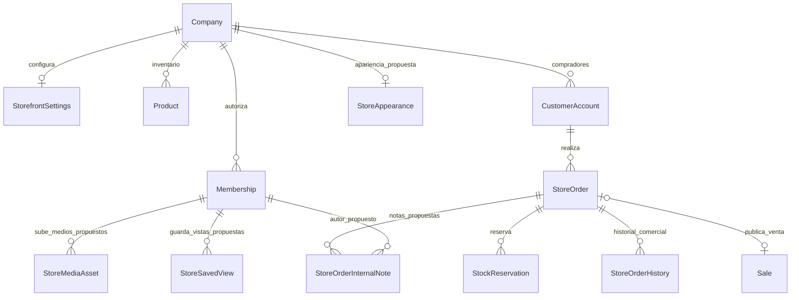

# Modelo de datos: reutilización y extensiones

Parte de la [propuesta del Centro de tienda](README.md). Todo elemento marcado **propuesto** requiere implementación y migración; este documento no cambia `schema.prisma`.

## 1. Principio de diseño

Separar el panel administrativo no exige crear otra compañía, otro inventario, otras cuentas de compradores ni otros pedidos. El MVP del workspace utiliza las tablas actuales. Las tablas adicionales se incorporan únicamente junto con la función que las necesita.

### Autoridades existentes

| Entidad                                                                     | Datos que ya resuelve                                                             | Tratamiento                                                                                |
| --------------------------------------------------------------------------- | --------------------------------------------------------------------------------- | ------------------------------------------------------------------------------------------ |
| `Company`                                                                   | Identidad, slug, moneda, zona horaria y estado                                    | Reutilizar; una tienda por compañía                                                        |
| `Membership` / `User`                                                       | Autoridad del personal                                                            | Reutilizar; no reemplazar con `CustomerAccount`                                            |
| `StorefrontSettings`                                                        | Publicación, registro, checkout, impuestos, reserva, nombre/descripción y versión | Reutilizar                                                                                 |
| `Product`, `ProductPresentation`                                            | Nombre, precio, imagen, visibilidad y orden del catálogo                          | Reutilizar; edición administrativa con DTOs acotados                                       |
| `ProductBatch`, `StockReservation`, `StockReservationAllocation`            | Disponibilidad, lotes y reservas                                                  | Reutilizar las restricciones y servicios actuales                                          |
| `Customer`, `CustomerAccount`, `CustomerAddress`                            | Datos y relación comercial por compañía                                           | Proyecciones autorizadas; no duplicar compradores en una tabla de “clientes del dashboard” |
| `StoreCart`, `StoreCartItem`, `StoreQuote`                                  | Carrito versionado y cotización con snapshot                                      | Conservar contratos                                                                        |
| `StoreOrder`, `StoreOrderHistory`                                           | Pedido, snapshot, estado, pago, entrega, historial y vínculo con venta            | Fuente de la operación y lecturas administrativas                                          |
| `StorePaymentMethod`, `StoreShippingMethod`                                 | Configuración de cobro/retiro/delivery                                            | Reutilizar; ordenar/presentar mejor sin otro modelo paralelo                               |
| `StorePaymentIntegration`, `StorePaymentAttempt`, `StorePaymentEvent`       | Pasarela, intento y conciliación                                                  | No exponer secretos cifrados ni payloads completos en el dashboard                         |
| `StorePaymentProof`, `StoreRefund`                                          | Comprobantes privados y devolución total                                          | Mantener separados de medios públicos                                                      |
| `Sale`, `SaleItem`, inventario/kardex                                       | Venta y movimientos efectivos                                                     | No convertir el dashboard en una segunda contabilidad                                      |
| `Notification`, `StoreNotification`, `StoreMail`, `OutboxEvent`, `AuditLog` | Avisos, envío durable y auditoría                                                 | Reutilizar, con proyecciones acotadas al negocio                                           |

No crear `StoreOrderItem` como nueva autoridad: el pedido conserva líneas en `snapshot`; las líneas de venta están en `SaleItem`. Una futura proyección analítica de líneas sería derivada, reconstruible y de solo lectura.

## 2. Extensiones por alcance

| Cambio propuesto                       | Necesidad                                          | Momento                                           |
| -------------------------------------- | -------------------------------------------------- | ------------------------------------------------- |
| Índices operativos de `StoreOrder`     | Bandejas filtradas y dashboard                     | Medir en piloto; antes de abrir a volúmenes altos |
| `StoreAppearance`                      | Vista previa, borrador y publicación de apariencia | Fase de apariencia                                |
| `StoreMediaAsset`                      | Logo/portada y medios públicos administrados       | Fase de apariencia; no migrar comprobantes        |
| `StoreOrderInternalNote`               | Coordinación interna que nunca ve el comprador     | Fase de operación colaborativa                    |
| `StoreSavedView`                       | Filtros/columnas guardados por administrador       | Fase de vistas persistentes                       |
| `Membership @@unique([companyId, id])` | Relaciones compuestas de las entidades anteriores  | Junto con la primera entidad que lo referencia    |
| Orden/descripción/plazos de métodos    | Mejor presentación comercial                       | Adición opcional compatible                       |
| Hechos financieros fechados            | Analítica de cobros/reembolsos por fecha efectiva  | Posterior; no requisito del shell/dashboard MVP   |

No se necesita un nuevo modelo `Store` para este alcance. Si más adelante una compañía requiere varias tiendas, deberán decidirse antes claves, inventario, configuración y significado de cada `slug`; no introducir `storeId` parcialmente en el modelo actual.

## 3. Relaciones objetivo



Todas las relaciones nuevas entre datos de un negocio incluyen `companyId`. Para una nota, `orderId` y `authorMembershipId` deben pertenecer a la misma compañía mediante claves foráneas compuestas, no solo mediante comprobaciones de UI.

Los identificadores de medios dentro de un JSON de apariencia no tienen una FK automática. Su pertenencia, estado y utilización se validan de forma explícita al guardar/publicar/archivar; el diagrama no pretende una relación SQL que no existe.

## 4. Esquema de las nuevas entidades

Los fragmentos Prisma siguientes definen el diseño. No son un archivo de migración ejecutable aislado: requieren campos inversos en `Company`, `Membership` y `StoreOrder`, nombres de relación y validación del esquema integrado.

### 4.1 `StoreAppearance` — propuesta

```prisma
model StoreAppearance {
  companyId             String   @id @map("company_id")
  schemaVersion         Int      @default(1) @map("schema_version")
  draft                 Json
  published             Json?
  draftVersion          Int      @default(1) @map("draft_version")
  publishedVersion      Int?     @map("published_version")
  updatedByMembershipId String   @map("updated_by_membership_id")
  publishedAt           DateTime? @map("published_at")
  updatedAt             DateTime @updatedAt @map("updated_at")

  company Company @relation(fields: [companyId], references: [id], onDelete: Restrict)
  editor Membership @relation(fields: [companyId, updatedByMembershipId], references: [companyId, id], onDelete: Restrict)
  @@map("store_appearance")
}
```

JSON permitido, validado con esquema cerrado y límites:

```json
{
  "schemaVersion": 1,
  "themePreset": "petroleo-crema",
  "headline": "Tu selección, a un paso",
  "heroDescription": "Productos preparados por nuestro negocio.",
  "logoAssetId": null,
  "coverAssetId": null,
  "showDescription": true,
  "showBusinessPhone": false
}
```

- `headline`: texto plano, máximo 80 caracteres. `heroDescription`: máximo 240.
- Presets enumerados; no CSS, JavaScript, HTML, URLs arbitrarias ni códigos de seguimiento libres.
- El nombre comercial sigue siendo `StorefrontSettings.title` con respaldo en `Company.name`; no duplicarlo como otra identidad editable en este JSON.
- `PATCH /appearance` exige `expectedDraftVersion`; `UPDATE` condicionado y 409 si hay conflicto.
- Publicar exige versión del borrador y versión publicada esperada; validar todos los medios `READY`, del mismo negocio y propósito compatible.
- Copiar el JSON validado al publicado en una transacción; registrar auditoría y evento de invalidación posterior al commit. La vista pública solo lee `published`.
- Una actualización puramente visual no modifica la versión comercial usada para validar cotizaciones. No cambiar incidentalmente la semántica actual de `StorefrontSettings.version`.
- Borradores, previsualización y datos de editor: privados, `no-store`, sin indexación y sin acceso por un parámetro público `?draft=1`.

### 4.2 `StoreMediaAsset` — propuesta

```prisma
enum StoreMediaPurpose {
  LOGO
  HERO
  PRODUCT
}

enum StoreMediaState {
  PROCESSING
  READY
  REJECTED
  ARCHIVED
}

model StoreMediaAsset {
  id                   String   @id @default(cuid())
  companyId            String   @map("company_id")
  uploadedByMembershipId String @map("uploaded_by_membership_id")
  purpose              StoreMediaPurpose
  state                StoreMediaState @default(PROCESSING)
  storageKey           String   @unique @map("storage_key")
  mimeType             String   @map("mime_type") @db.VarChar(64)
  byteSize             Int      @map("byte_size")
  width                Int
  height               Int
  checksum             String   @db.Char(64)
  createdAt            DateTime @default(now()) @map("created_at")
  archivedAt           DateTime? @map("archived_at")

  uploader Membership @relation(fields: [companyId, uploadedByMembershipId], references: [companyId, id], onDelete: Restrict)
  @@unique([companyId, id])
  @@index([companyId, purpose, state, createdAt])
  @@map("store_media_assets")
}
```

Solo medios públicos de marca/catálogo en esta fase. Los comprobantes siguen en `StorePaymentProof`, cifrados y con endpoint privado; no se reutiliza su almacenamiento para un logo público.

El servidor genera la clave bajo un prefijo de compañía, valida firma real/MIME/píxeles/tamaño y vuelve a codificar la imagen. Una subida pendiente no es una imagen publicada. La URL se deriva de un origen de almacenamiento permitido, no de una URL enviada por el usuario.

Agregar CHECK de tamaño/dimensiones positivos y límites acordes al pipeline. Archivar un medio referenciado por borrador/publicación se rechaza o requiere reemplazo; bloquear las filas implicadas en orden estable para evitar una carrera entre publicar y archivar. Limpiar huérfanos mediante tarea con retención definida, sin borrar los medios en uso.

Las imágenes actuales `Product.imageUrl` pueden seguir siendo data URLs durante la transición. Un futuro `Product.primaryStoreAssetId` debe tener FK compuesta y respaldo a `imageUrl` para productos aún no migrados. No copiar todas las imágenes en una única transacción de despliegue.

### 4.3 `StoreOrderInternalNote` — propuesta

```prisma
model StoreOrderInternalNote {
  id                 String   @id @default(cuid())
  companyId          String   @map("company_id")
  orderId            String   @map("order_id")
  authorMembershipId String   @map("author_membership_id")
  body               String   @db.VarChar(2000)
  createdAt          DateTime @default(now()) @map("created_at")

  order StoreOrder @relation(fields: [companyId, orderId], references: [companyId, id], onDelete: Restrict)
  author Membership @relation(fields: [companyId, authorMembershipId], references: [companyId, id], onDelete: Restrict)
  @@index([companyId, orderId, createdAt, id])
  @@map("store_order_internal_notes")
}
```

- Texto plano, entre 1 y 2000 caracteres, sin adjuntos o HTML en MVP.
- Notas append-only; una corrección se agrega como nueva nota. No editar el historial del comprador para resolver coordinación interna.
- DTO administrativo propio. Nunca incluir notas en `StoreOrder.snapshot`, `StoreOrderHistory` o endpoints `/store/:slug/orders`.
- Autor obtenido de la sesión/membresía, no del body.
- No eliminar membresías con notas históricas: desactivarlas y conservar atribución; definir anonimización/retención por separado si corresponde.

### 4.4 `StoreSavedView` — propuesta

```prisma
model StoreSavedView {
  id            String   @id @default(cuid())
  companyId     String   @map("company_id")
  membershipId  String   @map("membership_id")
  resource      String
  name          String   @db.VarChar(80)
  schemaVersion Int      @default(1) @map("schema_version")
  definition    Json
  isDefault     Boolean  @default(false) @map("is_default")
  version       Int      @default(1)
  createdAt     DateTime @default(now()) @map("created_at")
  updatedAt     DateTime @updatedAt @map("updated_at")

  membership Membership @relation(fields: [companyId, membershipId], references: [companyId, id], onDelete: Cascade)
  @@unique([companyId, membershipId, resource, name])
  @@index([companyId, membershipId, resource])
  @@map("store_saved_views")
}
```

`resource` se limita a `ORDERS`, `CATALOG` y `CUSTOMERS`. La definición usa IDs de columnas y filtros enumerados, por ejemplo `{ "layout": "board", "queue": "preparation", "sort": "oldest", "columns": ["number", "paymentStatus", "totalAmount"] }`.

No almacena SQL, nombres de campos arbitrarios, tokens, comprobantes, DNI, email ni búsquedas personales. No concede permisos y se vuelve a validar al leer. Un índice único parcial garantiza como máximo una vista predeterminada por `(company_id, membership_id, resource)` cuando `is_default = true`. Limitar inicialmente a 20 vistas por recurso/membresía, con serialización al crear y marcar predeterminada.

## 5. Índices y restricciones

### Ya presentes y que deben conservarse

- `StoreOrder`: unicidad de cotización, `(companyId, accountId, idempotencyKey)` y número por compañía.
- Relación compuesta entre pedido, cuenta comercial, cotización y venta.
- `StockReservation`: una reserva por propietario/producto; asignaciones vinculadas al mismo negocio/producto.
- Restricciones SQL de cantidades disponibles/reservadas de las migraciones existentes.
- Versiones de carrito y pedido e historial único por `(orderId, version)`.

### Candidatos para medir con EXPLAIN, no crear todos por defecto

| Consulta                         | Índice candidato                                                     |
| -------------------------------- | -------------------------------------------------------------------- |
| Bandeja general por fecha/cursor | `store_orders(company_id, created_at DESC, id DESC)`                 |
| Cobros por revisar               | `store_orders(company_id, payment_status, created_at DESC, id DESC)` |
| Preparación/entrega              | `store_orders(company_id, fulfillment, created_at DESC, id DESC)`    |
| Estado del pedido                | `store_orders(company_id, status, created_at DESC, id DESC)`         |
| Medios por propósito             | Índice de `StoreMediaAsset` descrito arriba                          |

El índice actual `(companyId, accountId, createdAt)` no reemplaza necesariamente el de bandeja global sin `accountId`. No indexar todas las claves del snapshot ni sumar índices redundantes sin volumen y medición. Si se usa `CREATE INDEX CONCURRENTLY`, ejecutar fuera de una transacción que lo prohíba y documentarlo en el despliegue.

`Membership` necesita añadir `@@unique([companyId, id])` antes de las FK propuestas. Es redundante respecto a la unicidad global del ID, pero necesario como destino explícito de relaciones compuestas.

## 6. Extensiones operativas opcionales

### Métodos de entrega/pago

Agregar de forma aditiva `sortOrder Int @default(0)` y una descripción pública acotada. Plazos estimados deben tener unidad explícita y validación mínimo ≤ máximo; no prometer fechas calculadas sin horarios/cortes de operación implementados.

Mantener los ubigeos de `StoreShippingMethod.districts`. Para mostrar distrito/provincia/departamento, incorporar un catálogo de referencia de ubigeos versionado; no se identificó uno en el módulo actual. No cambiar los códigos por nombres libres ni inferir cobertura por coincidencia de texto.

No presentar retiro como inventario de sucursal: que exista `branchId` en lotes no convierte el checkout central en una asignación completa de stock por local.

### Analítica financiera fechada — posterior

Para “cobros del día” y “reembolsos del día”, definir un registro append-only `StoreOrderFinancialEvent` con compañía, pedido, tipo `PAYMENT_CONFIRMED`/`REFUND_CONFIRMED`, importe decimal positivo, moneda, instante efectivo, instante de registro, origen `MANUAL`/`PROVIDER`, referencia autorizada y clave de deduplicación única por compañía.

Debe escribirse solo cuando el servicio de cobro/reembolso confirma el hecho, en la transacción correspondiente; incluir también pagos tardíos que requieren revisión y no generan venta. La clave estable del hecho evita duplicados por webhooks y reintentos. No es un saldo editable ni sustituye la venta o conciliación existentes.

Los históricos no tienen timestamps financieros completos para reconstruir todos los hechos con precisión. Marcar el período de cobertura de la nueva métrica y no inventar fechas a partir de `StoreOrder.createdAt`. Esta entidad no es requisito para el dashboard operativo inicial.

## 7. Migración y compatibilidad

1. Entregar primero workspace/consultas sobre modelos actuales, sin migración comercial.
2. Migraciones aditivas de índices y, cuando se implementen las funciones, clave compuesta de membresía y tablas nuevas.
3. Generar Prisma y probar la cadena completa sobre PostgreSQL/PGlite, incluidas FK cruzadas y CHECK.
4. Desplegar API tolerante a datos nuevos ausentes: apariencia por defecto, notas/vistas vacías, imágenes antiguas soportadas.
5. Poblar apariencia inicial bajo demanda desde título/estilo existentes; no crear vistas guardadas por cada usuario automáticamente.
6. Activar funciones nuevas por compañía, después de medir lectura y permisos.
7. Revertir mediante flag/rutas; conservar tablas y datos añadidos. No eliminar snapshots, pedidos o reservas para revertir una UI.

No añadir campos decorativos a la transacción crítica de confirmación. La base de datos y los servicios actuales siguen garantizando pedido único, stock protegido y limpieza atómica del carrito.
