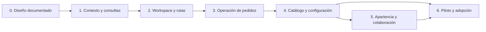

# Plan de integración por fases

Complementa la [arquitectura](README.md), el [modelo de datos](modelo-datos.md) y el [diseño UI/UX](diseno-ui-ux.md).

La fase 0 contiene el diseño original. La base de las fases 1 y 2 está implementada; ver [alcance y evidencia](implementacion-fases-1-2.md). Las fases 3 y 4 también están implementadas; consultar su [detalle y verificación](implementacion-fases-3-4.md). La [fase 5](implementacion-fase-5.md) incorpora apariencia y colaboración. La [fase 6](implementacion-fase-6.md) entrega controles de adopción, medición sintética y validación local; la activación de un negocio real y su medición de despliegue siguen pendientes.

## 1. Secuencia y alcance

El MVP se puede validar al terminar las fases 1–4. Las extensiones de la fase 5 no bloquean separar la administración de la tienda.

| Fase | Rama sugerida para implementación                  | Entrega                                              | Estado      |
| ---- | -------------------------------------------------- | ---------------------------------------------------- | ----------- |
| 0    | No requiere rama de producto                       | Diagnóstico, arquitectura, datos, UX y prototipo     | Documentada |
| 1    | `arquitectura/01-contexto-consultas-tienda`        | Contratos, contexto autorizado y lecturas operativas | Base implementada; medición pendiente |
| 2    | `arquitectura/02-espacio-administrativo-tienda`    | Layout propio, rutas y compatibilidad                | Implementada |
| 3    | `arquitectura/03-operacion-pedidos-pagos-entregas` | Bandejas, detalle, comandos y actualización en vivo  | Implementada en subrama 03-04 |
| 4    | `arquitectura/04-catalogo-clientes-configuracion`  | Pantallas de gestión separadas y formularios         | Implementada en subrama 03-04 |
| 5    | `arquitectura/05-apariencia-notas-vistas`          | Datos aditivos, editor y colaboración                | Implementada; ver implementación de fase 5 |
| 6    | `arquitectura/06-validacion-piloto-tienda`         | Pruebas, medición y adopción progresiva              | Controles y validación local implementados; piloto real pendiente |

Crear las ramas cuando se inicie la implementación, desde una base actualizada. Una rama de integración sugerida es `mejora/centro-tienda`. Cada fase termina con pruebas y commit en español antes de cambiar de rama. Conservar dependencias por ascendencia o integrar cada fase verificada en esa rama; no mezclar ambas estrategias sin documentarlo. No integrar en `main` cambios de rutas que aún dependan de APIs ausentes.

## 2. Fase 1 — Contexto, autorización y lecturas

### Trabajo

1. Especificar DTOs de `/store-admin/context` y `/dashboard`, con empresa y fechas derivadas/validadas por servidor.
2. Encapsular la política `MANAGE`/`CLOSEOUT` conservando comportamiento actual de dueños, sesiones revocadas y compañías restringidas.
3. Mantener `COMPANY_ADMIN` y `store:manage` como alcance inicial; inventariar qué guards deben cambiar antes de una delegación futura.
4. Implementar agregaciones con las definiciones de métricas del diseño; rangos acotados y zona horaria de compañía.
5. Añadir filtros administrativos sin retirar contratos legados de arrays/paginación `page` hasta migrar sus consumidores.
6. Obtener plan de consultas y probar índices candidatos con dataset representativo. Añadir solo los necesarios.
7. Definir claves de caché, invalidación y `allowedActions` como ayuda de UI, sin reemplazar validación del comando.

### Archivos principales previstos

- `backend/src/modules/store/admin/*` y DTOs administrativos nuevos.
- Controladores actuales de tienda, pedidos y servicios de consulta.
- Permisos/guards actuales cuando corresponda, sin ampliar roles por accidente.
- `frontend/features/store-admin/api/*` para contratos, fetch y claves de consulta.

### Aceptación

- Contexto de otra compañía no se puede elegir mediante body/query.
- Cliente comercial no obtiene contexto administrativo; administradores de plataforma no se convierten en dueños implícitos.
- Modo de atención histórica permite solo operaciones existentes autorizadas.
- Métricas se obtienen del conjunto completo, con límites de fecha y sin doble conteo por joins.
- Los tests del checkout, reservas y notificaciones siguen pasando.

## 3. Fase 2 — Entrada al módulo y shell independiente

### Trabajo

1. Crear `(commerce-admin)/comercio/layout.tsx` con sesión/contexto y `CommerceShell`.
2. Implementar sidebar, topbar, selector de módulo, nombre de tienda, avisos y enlace a la tienda del cliente.
3. Añadir rutas de resumen y páginas por función con estados de carga/error propios.
4. Actualizar sidebar principal, `role-navigation.ts`, `proxy.ts` y requisitos de plan para la ruta nueva.
5. Mover el alias `/store` al grupo adecuado y retirar su ruta anterior para evitar duplicados. Resolver la entrada según contexto.
6. Redirigir `/atencion-tienda` a la nueva atención histórica sin heredar el layout general que bloquea compañías restringidas.
7. Reutilizar proveedores de sesión, tema, Query y notificaciones, sin duplicar conexiones SSE.

### Aceptación

- Desde Gestión de ventas se entra en otra página con navegación propia y se puede volver.
- Recargar un enlace profundo conserva la sección y exige autorización.
- Los enlaces antiguos de avisos a `/store` siguen funcionando.
- No hay dos archivos de Next.js resolviendo la misma URL.
- El modo restringido no abre configuración/catalogación ni pierde la atención de pedidos pendientes.

## 4. Fase 3 — Pedidos, pagos y entregas

### Trabajo

1. Extraer la bandeja y el detalle del componente monolítico a rutas dedicadas.
2. Implementar filtros, paginación, tablas/tarjetas responsive y tablero de colas derivadas.
3. Mantener versión y acción permitida al ejecutar comandos; tratar 409 con recarga y explicación.
4. Separar visor privado de comprobantes, revisión de cobros e incidencias de pasarela.
5. Implementar vistas de retiro y delivery con estados reales y referencias de seguimiento.
6. Conectar invalidación de detalle/bandejas/resumen a notificaciones y reconciliación tras reconexión.
7. Conservar errores cerca de la acción, estado de progreso y recuperación de pedidos ya registrados.

### Aceptación

- Un tablero no paga ni reembolsa por movimiento visual de una tarjeta.
- El efectivo al retirar puede prepararse con reserva vigente; no se entrega sin cobro.
- El pago tardío aparece en revisión, sin fingir que ya se publicó una venta.
- Reembolso y retorno físico se presentan como operaciones distintas.
- Un pedido nuevo o actualizado aparece en la bandeja del dueño sin duplicarse.
- Un fallo de integración o gráfico no oculta la lista de pedidos.

## 5. Fase 4 — Catálogo, clientes y configuración

### Trabajo

1. Separar publicación del catálogo de edición de inventario/precio fuente.
2. Listas/galería, búsqueda, categorías, estado activo/publicado y vistas previas.
3. Listado y detalle de cuentas comerciales con datos mínimos; suspensión comercial acotada a esa compañía.
4. Dividir configuración en pago, entrega y reglas. Mostrar primero métodos ya configurados y su estado.
5. Validar formularios con esquemas compartidos y DTOs; no enviar campos ocultos incompatibles con el tipo de entrega.
6. Verificar que métodos ordenados/habilitados se reflejen en el checkout existente y que cambios comerciales invaliden cotizaciones según sus reglas.
7. Añadir catálogo de ubigeos legible solo cuando haya fuente y mantenimiento definidos; conservar validación por código.

### Aceptación

- Ningún producto se publica por defecto ni se edita stock desde un interruptor de catálogo.
- Deshabilitar un método no altera snapshots históricos.
- La vista del cliente usa datos de su compañía y los totales siguen siendo del servidor.
- Formularios legibles, datos conservados tras error y sin secretos previamente guardados en inputs.
- El módulo ya es útil de extremo a extremo sin esperar las tablas opcionales de apariencia/notas/vistas.

## 6. Fase 5 — Apariencia, notas y vistas persistentes

Implementar por subentregas independientes, cada una detrás de su capacidad:

1. Añadir la clave compuesta de `Membership` y las tablas de la función correspondiente.
2. Editor de apariencia con borrador/versiones, carga de medios y preview privado.
3. Publicación atómica de configuración visual validada, con fallback a apariencia anterior.
4. Notas internas con endpoint y DTO privados que no alcancen el portal del comprador.
5. Vistas guardadas por membresía/recurso, con filtros permitidos y una sola predeterminada.
6. Registrar auditoría e invalidar lecturas después del commit; no añadir cargas pesadas a la transacción de confirmar compra.

### Aceptación

- No se publican cambios de borrador sin acción explícita.
- Un medio de otra compañía no puede usarse como logo/portada.
- Un cliente comercial no obtiene notas internas ni datos de editor.
- Guardar una vista no permite construir SQL ni recuperar columnas sin permiso.
- Volver al panel anterior no requiere borrar tablas ni datos nuevos.

## 7. Fase 6 — Validación, piloto y adopción

### Matriz de pruebas

| Área             | Casos obligatorios                                                                                                        |
| ---------------- | ------------------------------------------------------------------------------------------------------------------------- |
| Rutas            | Alias antiguos, entrada nueva, recarga profunda, navegación atrás/adelante y ausencia de rutas duplicadas                 |
| Identidad        | Sin sesión, comprador comercial, dueño de A, dueño de B, roles no admitidos, sesión/membresía revocada                    |
| Modo restringido | Atender históricos autorizados sin habilitar catálogo, nuevas compras ni integraciones                                    |
| Datos            | FK compuestas, campos extra, IDs/cursors malformados, filtros/fechas fuera de rango y respuestas sin secretos             |
| Métricas         | Más de una página de pedidos, joins sin duplicados, medianoche en Lima, período vacío, reembolso y pago tardío            |
| Operación        | Estados de entrega, efectivo al retirar, comprobante rechazado, webhook duplicado, reserva vencida, reintento idempotente |
| Estado cliente   | Caché/SSE al cambiar compañía, respuesta tardía del tenant anterior y logout con consultas pendientes                     |
| Apariencia       | Conflicto de versión, medio no preparado, medio ajeno, publicación fallida y fallback                                     |
| Accesibilidad    | Teclado, lector de pantalla en flujos clave, contraste, zoom 200 %, foco y movimiento reducido                            |
| Responsive       | 320, 390, 768, 1024 y 1440 px, sin ocultar las acciones esenciales                                                        |
| Rendimiento      | Consultas EXPLAIN, tamaños de página, cargas parciales, entorno caliente y arranque en frío medidos por separado          |

### Activación

- Flag de experiencia administrativa por compañía. No reutilizar `StorefrontSettings.enabled` o `checkoutEnabled`: esos controlan ventas, no la versión del panel.
- Primero un negocio piloto autorizado, con lecturas contrastadas contra el panel actual.
- Ensayar cobros/pasarela en entorno controlado; separar las pruebas de UI con fixtures de un cobro real.
- Observar errores de rutas, 403/409/5xx, duración de consultas, retrasos de avisos y abandono de formularios.
- Ampliar a un grupo pequeño y después al resto, cuando los criterios de aceptación se cumplan.
- Actualizar manuales y enlaces de notificación para usar detalles canónicos, manteniendo el alias legado.

### Reversión

Desactivar el flag devuelve al panel anterior o a una entrada estable. Las operaciones comerciales, pedidos, snapshots, reservas, pagos y avisos continúan usando los mismos servicios. No ejecutar migraciones destructivas ni borrar datos para volver atrás.

## 8. Riesgos concretos y respuestas

| Riesgo                                                     | Respuesta de integración                                                |
| ---------------------------------------------------------- | ----------------------------------------------------------------------- |
| Repetir la página gigante con un menú nuevo                | Cada función tiene ruta, consulta y carga propias                       |
| Perder el modo de atención al salir del layout antiguo     | Pruebas de `CLOSEOUT` antes de activar el shell                         |
| Dashboard con cifras de los primeros 30 pedidos            | Agregados del servidor y dataset multipágina                            |
| React Query conserva datos de otra compañía                | Claves con tenant/membresía, cancelación y limpieza al cambiar contexto |
| Duplicar lógica de cobro o reserva                         | Adaptadores administrativos que llaman a comandos existentes            |
| Hacer obligatorias tablas decorativas para abrir el módulo | MVP sin nuevos modelos comerciales; extensiones progresivas             |
| Borrador visible en tienda pública                         | Separación draft/published y preview autorizado                         |
| Deducir cobros/reembolsos de fechas incorrectas            | Métricas operativas honestas y hechos financieros posteriores           |

## 9. Evidencia de la fase documental

- Revisadas rutas, layouts, sidebar, navegación de roles, controladores, guards, servicios y modelos Prisma de la base indicada.
- Diseñados estados actual/propuesto, composición de UI, contratos, esquema aditivo, pasos y criterios.
- Prototipo HTML separado y rotulado como demostración; no integra APIs, credenciales o compañías reales.
- Prototipo comprobado en Chromium: navegación, alternancia de lista/tablero, filtro por número de pedido, detalle, nota local, previsualización, cambio de tema y anchos 320/390/768/1440 px; sin errores de JavaScript ni solicitudes HTTP externas.
- En la implementación se deben volver a ejecutar los checks pertinentes. Esta entrega documental no afirma que los nuevos endpoints, tablas o pantallas estén desplegados.
